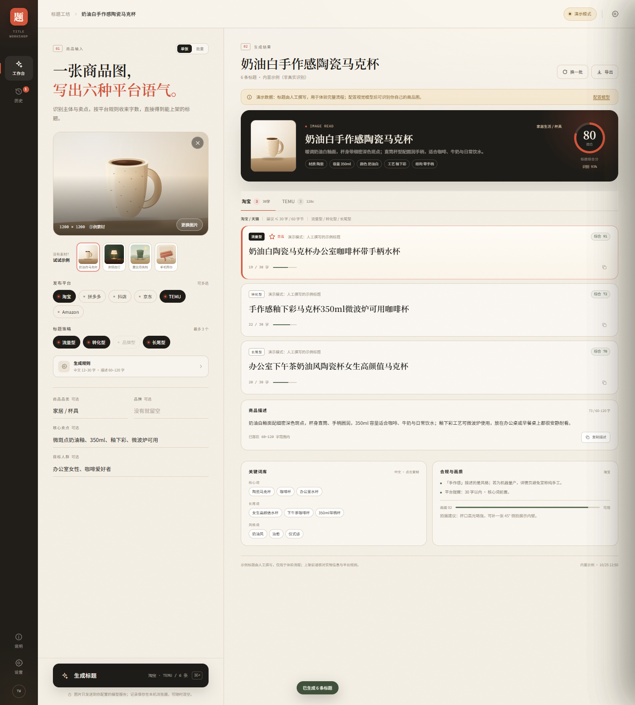
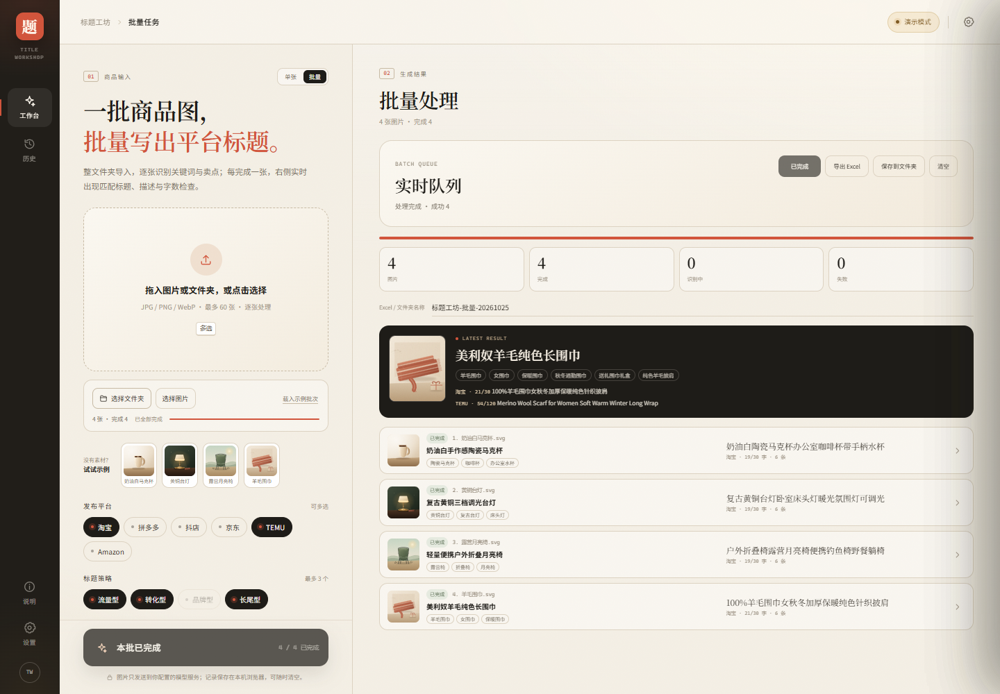
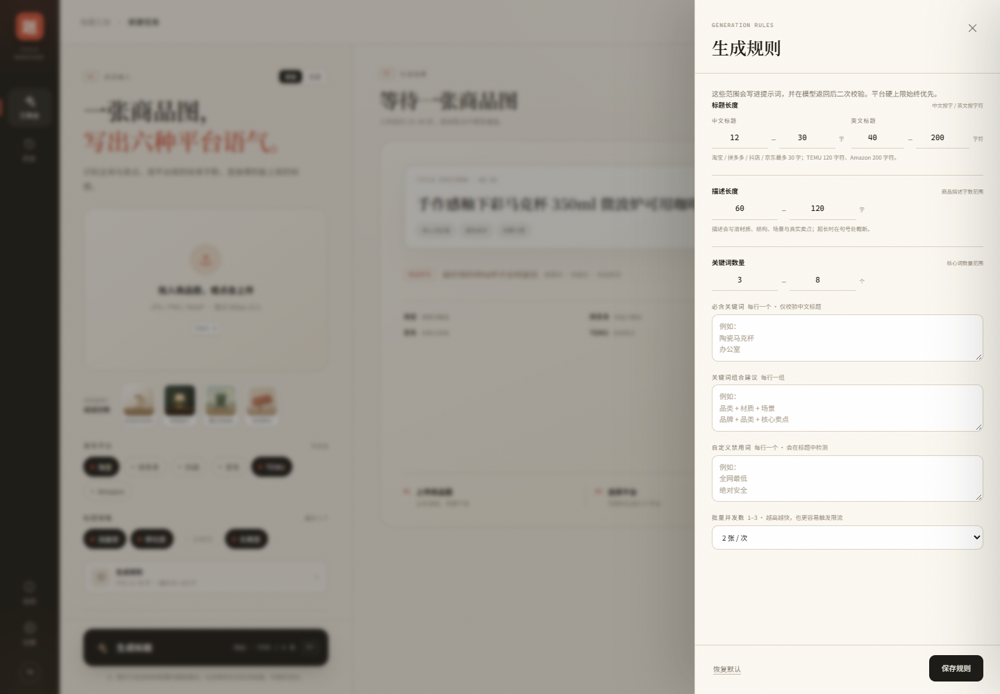

# 跨多多标题工坊 · 电商标题识图生成

[](https://github.com/hztengrui-ux/ecom-title-studio/releases/latest)
[](https://github.com/hztengrui-ux/ecom-title-studio/releases)

**⬇️ [下载最新桌面版 → Releases](https://github.com/hztengrui-ux/ecom-title-studio/releases/latest)** —— Windows 10/11 x64，免安装；单文件 exe 或 zip 任选，解压后双击 `KuaduoTitleWorkshop.exe`。

上传商品图，识别品类、材质、属性、场景与卖点，按不同平台的规则生成能直接上架的标题与商品描述。

支持 **淘宝 / 天猫、拼多多、抖店、京东、TEMU、Amazon** 六个平台；单张生成之外，还可以**导入整个文件夹批量处理**，逐张实时出关键词、标题和描述，最后导出 Excel，或直接保存到指定文件夹。



---

## Windows 桌面版

当前为 **2.1.0（Vue 3 + Element Plus 重写版）**，提供两种免安装分发（也可直接在 [Releases](https://github.com/hztengrui-ux/ecom-title-studio/releases) 下载）：

- `KuaduoTitleWorkshop-2.1.0-win-x64.exe`：自解压单文件，双击选目录，解压后双击 `KuaduoTitleWorkshop.exe`。
- `KuaduoTitleWorkshop-2.1.0-win-x64.zip`：完整解压后双击 `KuaduoTitleWorkshop.exe`。

不需要安装，不需要管理员权限。不要只复制 exe，也不要在压缩包里直接运行。

- **技术栈：Electron 33 + Vue 3 + Element Plus + Vite**；渲染层组件化，Node 后端接口保留。
- 原生独立窗口，不经过浏览器地址栏；本地服务固定使用 `127.0.0.1:47821`。
- 「文件 / 编辑 / 视图 / 帮助」已移到窗口右上角；原生菜单栏隐藏，快捷键仍可用。
- 「保存到文件夹」「导出 Excel」「导出 CSV」都会弹出 Windows 原生保存/选择文件夹对话框。
- 不需要安装 Node.js；Electron 运行时已经打包在文件夹里。
- 模型设置与 API Key **自动保存**；固定 origin 后，关闭软件再打开不会掉设置。
- 当前版本是便携版：整个文件夹可以放到任意目录，设置与历史保存在程序旁的 `KuaduoTitleWorkshop-data`，换电脑时连文件夹一起复制即可；目录不可写时会回退到 `%APPDATA%\KuaduoTitleWorkshop`。
- 首次启动会自动迁移旧的 `TitleWorkshop-data` / `%APPDATA%\TitleWorkshop`，原设置和历史不用重新配。

### 在线账号登录（2.1.0 起）

桌面版启动时会先要求登录，账号由跨多多统一开通：

- 登录接口：`https://api.kuaduoduo.vip/auth/login`（经本地服务 `127.0.0.1:47821/api/auth/*` 代理，避免跨域）。
- 登录成功后令牌保存在本机，下次启动自动免登录，并**每 30 分钟**向服务器校验一次。
- 账号到期、被管理员停用后，下一次校验即被拒绝并退回登录页，提示原因（即时收回，无需重新分发安装包）。
- 默认授权 30 天；续期、停用、改密由管理员在服务器上执行 `node admin.mjs`（`extend` / `disable` / `enable` / `reset`）。
- 顶部账号胶囊显示「账号（姓名）· 剩 N 天」，点开可「重新校验授权 / 退出登录」。
- 支持两种登录方式：**账号 / 手机号 + 密码**；或管理员在后台生成的**一次性登录码**（6 位数字，10 分钟内有效，只能使用一次）。登录页可直接切换。
- 管理员后台：https://api.kuaduoduo.vip/admin （管理员令牌登录；建号、续期、停用/启用、重置密码、生成登录码）。

### Windows SmartScreen 提示

如果双击时出现蓝色 **「Windows 已保护你的电脑」**，显示：

```text
应用：KuaduoTitleWorkshop.exe
发行者：发布者未知
```

这是 Windows SmartScreen 对**未签名、下载来源未知、尚无信誉**的 exe 的常规拦截，不是杀毒引擎报毒。

临时运行（推荐先解除锁定）：

1. 先不要解压：右键下载的 zip → **属性** → 勾选 **解除锁定 / Unblock** → 应用；
2. 再解压，双击 `KuaduoTitleWorkshop.exe`；
3. 如果仍提示，点提示框里的 **更多信息 → 仍要运行**。

也可以用 PowerShell：

```powershell
Unblock-File -LiteralPath "D:\你的目录\KuaduoTitleWorkshop-2.0.1-Portable.zip"
```

已经解压的，对 exe 执行同样的 `Unblock-File`。

彻底消除需要给 exe 做 **代码签名**（OV/EV 证书）；EV 证书能较快建立 SmartScreen 信誉。没有证书时，关闭 SmartScreen 或加 Defender 排除项会降低整机安全性，不建议。

### 代码签名（OV / EV）

仓库里没有证书，**不能伪造签名**；自签名证书不会消除 SmartScreen，必须用 CA 签发的 OV/EV 代码签名证书。

OV / EV 证书如果是 `.pfx`，设置：

```powershell
$env:CSC_LINK = "D:\cert\kuaduo-title-workshop.pfx"
$env:CSC_KEY_PASSWORD = "证书密码"
npm run sign:win
# 或直接让 electron-builder 签名并输出 zip：
npm run dist:sign
```

也可以给已经解压的 exe 单独签：

```powershell
npm run sign:win -- -ExePath "D:\跨多多标题工坊\KuaduoTitleWorkshop.exe"
```

签名脚本会使用 SHA-256 + DigiCert RFC3161 时间戳，并执行 `signtool verify /pa`。需要安装 Windows SDK 的 `signtool.exe`。

EV 证书通常是硬件令牌/云 HSM，不能导出 `.pfx`，要用证书厂商提供的签名工具（DigiCert KeyLocker、SSL.com eSigner 等）把签名注入 exe；`signtool` 的 `/f` 只适用于可导出的 PFX。

如果只是开发调试，才需要 Node.js 20+：

```powershell
npm install
npm run dev        # Vite 前端开发服务器（另开一个终端跑 npm run dev:server）
npm run dev:server # 本地 Node API，默认 127.0.0.1:8787
npm run build      # 构建 Vue 渲染层到 public/
npm test           # 标题规则 + API + xlsx 集成测试
npm run desktop    # 启动 Electron 桌面窗口（使用已构建的 public/）
npm run dist:folder # 打包 release/win-unpacked（不含安装器）
```

---

## 两种模式

### 单张

上传一张商品图，生成六个平台的标题、商品描述、关键词库与合规提示。


### 批量

点「批量」后选择整个文件夹（或拖入文件夹），队列会逐张处理：

- **默认发布平台是 TEMU**，可再切到淘宝、拼多多、抖店、京东或 Amazon；
- 左侧显示导入数量、完成/失败数、当前进度；
- **图片文件名就是 SKU**，列表/结果卡/Excel 都以文件名作为货号；
- 顶部搜索框可按**图片文件名 / SKU**筛选队列；
- 右侧实时出现每张图的**关键词、各平台标题、描述**；
- **每个平台只生成 1 条标题**（批量与单张一致；单张时在「标题策略」里选风格，模型按该策略出这 1 条），token 与人工审核成本最低；
- **快速模式默认开启**：不生成思维链，单张成本约为原来的 1/5、耗时缩短 60% 以上；设置里或批量设置里都可以关闭（复杂商品需要更强推理时关掉）；
- 英文标题会附**中文对照**，中文标题会附英文对照（模型返回时展示）；
- 每行是一条图片记录，点开可勾选标题；支持每张图「全选 / 全不选」；
- 默认全部勾选，取消勾选后「导出已选 Excel / CSV / 文件夹」只导出勾选内容；
- 「预览文件夹」里的 HTML 预览也能直接勾选/取消标题，底部可 **导出已选 Excel** 或只保存勾选内容；
- **图片不限张数**，实际速度取决于模型限流、网络与本机内存；
- **启动前会先做图片压缩预处理**：可按键宽或最长边等比压缩到 548 / 768 / 1024 / 1280 / 1600 / 2048，或自己填 320–4096 的任意数字；
- 点「开始处理」后严格按 **① 预处理 → ② 识别** 执行，不会先识别再压缩；
- 可手动点「预处理」提前看压缩前后体积；
- 每张图会显示「已压缩 548×... · 320 KB」；
- 并发默认「自动」，根据 CPU/内存推荐 2–10；也可手动选 1–20；
- 「批量设置」里可直接填标题前缀/后缀、图片最长边、自定义提示词；
- 支持「停止」「清空」「重试失败项」。



---

## 生成规则（可设定）

点左侧「生成规则」，可以设定：

| 规则 | 默认 | 说明 |
|---|---|---|
| 中文标题长度 | 12–30 字 | 不超过平台硬上限 |
| 英文标题长度 | 40–200 字符 | TEMU 仍受 120 字符硬上限约束 |
| 商品描述长度 | 60–120 字 | 超长时在句号处截断 |
| 核心关键词数量 | 3–8 个 | 写入提示词，不作为硬性截断 |
| 必含关键词 | 空 | 每行一个；只校验中文标题，缺失会逐条标记 |
| 关键词组合建议 | 空 | 每行一组，例如「品类 + 材质 + 场景」 |
| 自定义禁用词 | 空 | 每行一个；在内置极限词之外再检测 |
| 快速模式 | 开 | 请求时不带思考链（thinking disabled）：DeepSeek 实测单张 4 秒 / 718 output tokens，关闭时约 11 秒 / 1921 tokens；只对 DeepSeek、火山方舟生效，OpenAI 等兼容服务会自动跳过 |
| 批量并发数 | 自动 | 自动按 CPU/内存推荐 2–10；手动 1–20 |

规则会写入提示词，并在模型返回后做二次校验：标题按平台上限与设定范围截断，描述按范围截断，禁用词与必含词在结果里逐条标记。



### 批量设置

批量页里的「批量设置」是常用参数的快捷入口：

| 参数 | 说明 |
|---|---|
| 标题类型 | 默认「素材描述」；需要按具体商品上架时切到「商品标题」 |
| 目标类目 | 通用素材（默认）/ 服装印花 / 家居装饰画 / 杯具餐具 / 文具贴纸 / 自定义；不选不写行业词 |
| 标题前缀 / 后缀 | 例如 `圣诞款`、`现货`；系统统一拼接并完整保留，模型不会重复添加；超长时只压缩中间标题 |
| 并发数 | 默认「自动」按 CPU/内存推荐 2–10；也可手动 1–20，越高越容易限流 |
| 缩放方式 | 按宽度等比 / 按最长边 |
| 目标尺寸 | 548 / 640 / 768 / 1024 / 1280 / 1600 / 2048，或手填 320–4096 |
| 目标长度 | 0 = 平台默认；填 180 也只会在平台硬上限内生效（TEMU 仍 ≤120） |
| 标题语言 | 跟随平台 / 中文 / English；强行指定中文时 TEMU 会变中文，需自行判断是否合适 |
| 禁用关键词 | 每行一个，标题和描述都会检测 |
| 提示词模板 | 标准电商 / 节日礼赠 / 参数优先 / 品牌调性；可再改成自定义 |
| 自定义提示词 | 追加到系统提示词，例如“突出红黑格纹与礼赠场景” |
| 保存位置 | 桌面版可直接选默认输出目录；不选则导出时再选 |
| 保存原图 | 默认勾选；取消后结果文件夹只写 Excel、预览、数据，不写原图 |
| 复用模板 | 存为模板 / 载入模板；JSON 文件可放到任意盘，不包含 API Key |

### 复用模板

批量设置里的「存为模板」会把以下参数写成一个 JSON：

- 标题类型、目标类目、前缀/后缀、目标长度、语言
- 并发、缩放方式、目标尺寸、保存原图
- 禁用词、自定义提示词、输出目录
- 当前发布平台与标题策略

不包含 API Key。把 JSON 存到 D 盘/E 盘或任意文件夹，下次点「载入模板」即可恢复；换电脑也能用。

标题长度、必含词、禁用词、关键词组合仍在「生成规则」里，避免批量页塞太多字段。

---

## 批量导出

完成至少一张后，工具栏会出现：

- **导出 Excel**：下载 `.xlsx`；
Excel 默认保存到 `KuaduoTitleWorkshop-data\导出`，不再默认落到可能没有写权限的「文档」。如果你手选了没有权限的目录，桌面版会自动改存到 `KuaduoTitleWorkshop-data\导出`，并在提示里给出实际路径。

- **保存到文件夹**：选择本机文件夹，写入
  - `跨多多标题工坊-批量-YYYYMMDD.xlsx`
  - `images/`（原图，按序号命名）
  - `跨多多标题工坊-批量-YYYYMMDD-预览.html`（可双击打开的结果页）
  - `跨多多标题工坊-批量-YYYYMMDD-数据.json`

Excel / CSV 只保留一张表、两列，直接可复制上架：

1. **批量结果**：一行一张图，只有 **SKU（图片文件名）** 与 **主标题** 两列；状态、商品名、品类、描述、关键词等中间结果不导出，减少人工筛选和文件体积。

> 桌面版的「保存到文件夹」「导出 Excel」「导出 CSV」使用 Windows 原生对话框；只有 Web 开发模式才走浏览器的 File System Access API 作为兜底。

---

## 素材模式（默认）

这个工具默认按「服装 / 印花 / 图案素材」处理，而不是按具体行业商品处理：

- 标题只写**画面素材**：主体、风格、颜色、构图、图案类型、艺术技法、氛围；
- 不写 `Home Decor`、`Living Room`、`Bedroom`、`Wall Art`、`装饰画`、`客厅`、`卧室`、`T恤`、`卫衣` 等行业/品类/用途词；
- 描述写画面与可印性，不假设具体商品用途；
- 关键词也只给素材词，不给行业关键词；
- 模型如果仍返回行业词，服务端会再做一层过滤。

**类目必须由你选，模型不能自己定。** 左侧「目标类目」：

- **通用素材（默认）**：不写行业词，结果卡显示「通用素材」；
- **服装 / 印花**：可写 apparel / print design 等通用词，但不写 T 恤、卫衣等具体款式；
- **家居 / 装饰画**：允许 Home Decor、Wall Art、客厅、卧室等；
- **杯具 / 餐具、文具 / 贴纸、其他自定义**：按所选类目写，不串行业。

不选目标类目时，不会再把模型猜出来的「家居饰品 / 装饰画」显示成结果类目。

如果确实要按具体商品写，在「批量设置 → 标题类型」切到 **商品标题（按品类/场景）** 即可。

## 能做什么

- **识图**：从商品图判断主体、类目、材质、颜色、结构、目标人群与使用场景，并提取与商品有关的文字。
- **按平台写**：淘宝要搜索词覆盖，拼多多要直给利益点，抖店要画面感，京东要参数，TEMU / Amazon 要自然英文。
- **四种策略可选其一**：流量型、转化型、品牌型、长尾型；填写品牌后才建议用品牌型。策略决定每个平台这 1 条标题的写法。
- **硬性约束**：中文标题按 30 字 / 60 字节和用户设定范围收敛；英文标题按 120 / 200 字符硬上限与用户范围收敛。
- **商品描述**：按设定字数生成一段可直接放进详情页/草稿的描述。
- **合规检查**：内置常见广告法风险词 + 自定义禁用词；必含词缺失也会标出。
- **可带走**：单条复制、关键词点击复制、CSV、批量 Excel、指定文件夹结果包、最近 12 次单张历史。

---

## 配置视觉模型

点右上角「演示模式」→ 选一个预设，填 API Key，保存。

| 预设 | 接口地址 | 模型示例 | 备注 |
|---|---|---|---|
| 通义千问 | `https://dashscope.aliyuncs.com/compatible-mode/v1` | `qwen-vl-max-latest` | 阿里云 DashScope 兼容模式 |
| 智谱 GLM | `https://open.bigmodel.cn/api/paas/v4` | `glm-4.5v` | BigModel 开放平台 |
| 硅基流动 | `https://api.siliconflow.cn/v1` | `Qwen/Qwen2.5-VL-72B-Instruct` | 以控制台实际模型名为准 |
| 火山引擎豆包 | `https://ark.cn-beijing.volces.com/api/v3` | `doubao-seed-1-6-vision-250815` | 方舟 Ark 视觉模型；旧 1.5 模型可能已下线，也可填推理接入点 `ep-...` |
| DeepSeek | `https://api.deepseek.com/v1` | `deepseek-flash` | 官方当前视觉模型；旧 `deepseek-chat` / `deepseek-reasoner` 是纯文本，会自动迁移 |
| Kimi 月之暗面 | `https://api.moonshot.cn/v1` | `kimi-k3.1-pro` | 原生多模态；旧 `moonshot-v1-vision` 已下线 |
| Google Gemini | `https://generativelanguage.googleapis.com/v1beta/openai` | `gemini-2.5-flash` | 走 Gemini 的 OpenAI 兼容层，支持图片 |
| OpenRouter | `https://openrouter.ai/api/v1` | `google/gemini-2.5-flash` | 聚合网关；模型必须支持图片输入 |
| Mistral | `https://api.mistral.ai/v1` | `pixtral-12b-2409` | Pixtral 视觉模型，模型名以控制台为准 |
| OpenAI | `https://api.openai.com/v1` | `gpt-4.1-mini` | 需要支持图片输入 |
| Ollama 本地 | `http://127.0.0.1:11434/v1` | `qwen2.5vl:7b` | 无需 Key，先 `ollama pull` |
| 自定义 | 任意兼容地址 | 任意视觉模型 | 需实现 `/chat/completions` |

豆包在火山方舟控制台开通视觉模型后，模型名称通常要填「推理接入点 ID」（`ep-...`）；部分账号已支持模型直调，可填 `doubao-seed-1-6-vision-250815`。旧版 `doubao-1.5-vision-pro` 可能已下线，报 `model not found` 时请重新选一次「火山引擎豆包」预设，或直接粘贴当前接入点。

> 兼容层会在 HTTP 400 时自动去掉 `response_format`、`max_tokens` 和图片 `detail` 参数重试一次，兼容方舟等实现差异；仍失败时，错误卡片会**自动展开技术细节**，里面通常有 Ark 的 `code` 与 `message`，可据此判断是接入点、权限还是参数问题。

DeepSeek 的官方视觉模型是 **`deepseek-flash`**（DeepSeek-V4.1-Flash，支持图片输入）；`deepseek-chat` / `deepseek-reasoner` 是纯文本模型，旧设置会自动迁移到 `deepseek-flash`。Kimi 当前用 `kimi-k3.1-pro`，旧 `moonshot-v1-vision` 系列已下线。

### 遇到 `EMPTY_RESPONSE`

意思是上游 HTTP 200，但 `message.content` 为空。现在会自动做三件事：

1. 如果 JSON 在 `reasoning_content` 里，直接回退读取；
2. 去掉 JSON Mode、提高输出预算后重试一次；
3. 仍为空时，技术细节里会带 `finish_reason`、`message_keys`、`usage` 和上游原始响应片段。

常见原因是：模型不支持 JSON Mode、输出预算被思维链占满、模型只有 reasoning 没有最终 content、或图片被安全策略拦截。把自动展开的技术细节发我即可继续定位。

接口地址填到 `/api/v3` 即可；即使误填了 `/chat/completions`，服务端也会自动去掉。

只要服务兼容 OpenAI 的 `POST /chat/completions`，并接受：

```json
{
  "model": "your-vision-model",
  "messages": [{
    "role": "user",
    "content": [
      { "type": "text", "text": "..." },
      { "type": "image_url", "image_url": { "url": "data:image/jpeg;base64,..." } }
    ]
  }]
}
```

就可以直接用。

### 用环境变量启动（不把 Key 放进浏览器）

```powershell
$env:VISION_BASE_URL="https://ark.cn-beijing.volces.com/api/v3"
$env:VISION_API_KEY="..."
$env:VISION_MODEL="doubao-seed-1-6-vision-250815"
node server.mjs
```

也支持 `VISION_PROVIDER=ollama`。检测到环境变量时，页面首次打开会自动显示「服务端模型」。

> API Key 只保存在本机 `localStorage`（或服务端环境变量），不会写入项目文件、不会写日志。请不要把 Key 提交到 Git。

---

## 使用流程

1. **上传商品图 / 文件夹**：点击、拖拽，或直接 `Ctrl+V` 粘贴。JPG / PNG / WebP，单张建议 800px 以上。
2. **选示例**（可选）：四张内置示例图，覆盖杯具、灯具、户外、服饰。
3. **补三行信息**（可选）：品类、核心卖点、目标人群。批量时这些信息会应用到整批。
4. **选平台与策略**：平台可多选；标题策略单选（流量 / 转化 / 品牌 / 长尾），每个平台只出 1 条标题。
5. **生成**：单张点「生成标题」，批量点「开始批量处理」（或 `Ctrl/Cmd + Enter`）。
6. **导出 / 保存**：复制、导出 CSV，或批量导出 Excel / 保存到文件夹。

---

## 平台字数

| 平台 | 建议上限 | 写法 |
|---|---|---|
| 淘宝 / 天猫 | 30 字 / 60 字节 | 核心词前置，属性 + 场景 |
| 拼多多 | 30 字 / 60 字节 | 利益点直给，少形容词 |
| 抖店 | 30 字 / 60 字节 | 画面感、口语化、人群词 |
| 京东 | 30 字 / 60 字节 | 规格、材质、型号优先 |
| TEMU | 120 字符 | 自然英文，关键词 + 场景 |
| Amazon | 200 字符 | 核心词 + 属性 + 使用场景 |

平台规则会调整，以上是常用建议上限；真正上架前以商家后台提示为准。

---

## 工程结构

```text
ecom-title-studio/
├─ desktop/
│  ├─ main.cjs              Electron 主进程：窗口、菜单、原生保存对话框
│  └─ preload.cjs           受限的桌面桥（保存/打开路径）
├─ build/                   应用图标（png / ico）
├─ release/                 免安装 ZIP/SFX · win-unpacked · 旧版本归档
├─ server.mjs               本地服务：静态文件 + API 代理 + xlsx 导出
├─ lib/
│  ├─ platforms.mjs         六个平台规则、四种策略
│  ├─ rules.mjs             标题/描述/关键词/禁用词规则
│  ├─ vision.mjs            提示词、OpenAI 兼容调用、JSON 修复、错误映射
│  ├─ normalize.mjs         模型输出 → 稳定结构；过滤、去重、截断、打分
│  ├─ title.mjs             字数/字节、截断、极限词、评分
│  ├─ demo.mjs              四套人工示例数据
│  ├─ xlsx.mjs              零依赖 xlsx 写出（ZIP + OpenXML）
│  └─ batch-export.mjs      批量结果 → 四张工作表
├─ src/
│  ├─ main.js               Vue 3 + Element Plus 入口
│  ├─ App.vue               工作台外壳、右上角菜单、抽屉挂载
│  ├─ store.js              业务状态、请求、批量队列、导出、模板
│  ├─ api.js                fetch 超时与错误映射
│  ├─ components/           单张、批量、结果、设置、规则、预览、历史
│  └─ styles.css            Vue 组件样式 + 纸张/墨色/朱砂主题
├─ static/
│  └─ samples/*.svg         构建时复制的示例商品图
├─ public/                  Vite 构建产物（index.html + assets + samples）
├─ test/                    标题规则 + API + xlsx 集成测试
├─ docs/                    截图
└─ README.md
```

### 一次生成发生了什么

```text
图片（界面按设置压缩，默认 ≤1280px）
  → 本地 Node 代理（避免 CORS，统一超时、图片大小与错误映射）
  → 视觉模型（严格 JSON）
  → normalize：平台/策略过滤、去重、按规则截断、极限词/必含词检测、评分
  → 页面按平台展示；批量时逐张更新队列
```

**为什么要有本地代理**：大多数模型服务不允许浏览器跨域直接调用；把请求放在同源的 `/api/analyze` 后面，既避免 CORS，也能统一做超时、错误映射、图片大小校验与 JSON 修复。服务本身不持久化图片。

**评分**：关键词覆盖 45%、可读性 35%、合规 20%。综合分取每个平台得分最高的两条，避免一条偏弱的长尾标题拖低整体观感。评分用于横向比较，不是平台质量分。

**截断**：中文按字符与 GBK 字节双重限制；超限时优先在最后一个逗号、空格、竖线处截断，找不到才硬切。描述优先在句号处截断。

**零依赖 xlsx**：`lib/xlsx.mjs` 直接写 ZIP + OpenXML（inlineStr、基础样式、冻结首行、自动筛选），不安装 `exceljs` / `xlsx`，也不联网。

---

## 隐私与安全

- 图片只在你点击生成时，经本机 Node 服务发送到你配置的模型服务；服务端不落盘。
- 单张历史（含压缩图）保存在本机 `localStorage`（桌面版在 `KuaduoTitleWorkshop-data` 内），最多 12 条，可在「历史」里一键清空。
- 批量队列在内存中；只有你主动点「保存到文件夹」时，才会把 Excel、图片、预览页写入你选择的目录。
- API Key 保存在本机 `localStorage` 或服务端环境变量；不写项目文件、不写日志。
- 服务端带 CSP、路径穿越防护、16MB 请求体限制、8MB 图片限制；默认只监听 `127.0.0.1`。
- 这是本地单人工具，不是多租户服务。不要直接暴露到公网。

---

## 已知边界

- 模型会看错材质、颜色、结构；标题与描述生成后仍要人工核对，尤其是成分、认证、承重、功效。
- 极限词检测是常见规则集，不等于平台审核；不同类目还有特殊资质要求。
- 批量不限张数，实际速度取决于模型限流、网络与本机内存；超大图片会先压缩再发送，保存到文件夹时保留原图。
- TEMU / Amazon 标题为英文；描述为中文。如果英文是主战场，建议用英文能力更强的模型。
- 示例数据是人工撰写，页面会明确标注「非真实识别」，不会把示例冒充模型结果。
- 「保存到文件夹」依赖 File System Access API；Firefox / Safari 会自动退化为下载 Excel。

---

## License

内部工具示例，未附带开源许可证。使用前请确认所选模型服务与商品图片的授权范围。


